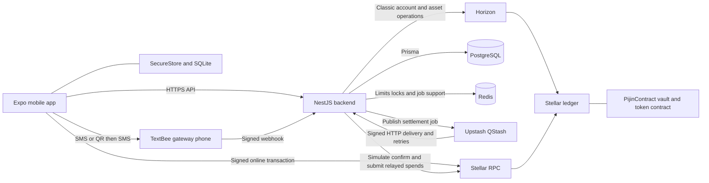
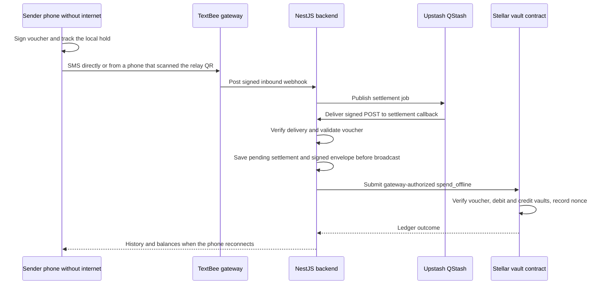

# HoneBill Capstone Defense Guide

HoneBill is a mobile wallet prototype for sending and receiving a peso-denominated test asset on Stellar. Its central feature is that a sender can authorize a payment without mobile data or Wi-Fi. The phone signs a compact voucher and hands it off by SMS, directly or through another phone that scans a relay QR. A connected backend and Stellar still have to settle it. An offline receipt means the app has recorded the handoff. The recipient's balance changes when the ledger applies the payment.

## 1. Opening explanation

> HoneBill addresses the moment when someone needs to pay but their phone has no internet connection. Users move test funds into an on-chain vault while online. Later, the phone uses an enrolled device key to sign a payment voucher and sends it through ordinary SMS. A gateway forwards the voucher, and our smart contract verifies the signature, checks the balance and prevents the same voucher from settling twice. The app shows the payment as pending until it learns the result. We demonstrate the system on Stellar Testnet.

Have each teammate answer four questions for every flow. Who authorizes it? How does the request travel? What component decides the result? How does that result reach the user?

## 2. Architecture and technology

| Layer | Technology and responsibility |
| --- | --- |
| Mobile | TypeScript, React 19.2, React Native 0.86.3 and Expo SDK 57 from the mobile manifest. React Navigation connects the screens. App-wide providers hold auth and wallet view state. Expo Camera supports QR scanning. The app has English and Filipino text. |
| Mobile security and offline storage | Expo SecureStore wraps OS-protected storage for signing secrets and the offline MPIN verifier. Expo SQLite and Drizzle support balances, history and durable queued work. NetInfo feeds RxJS connectivity and sync streams. |
| API and domain logic | Node.js 22 in CI, NestJS 11 on Express, TypeScript, request DTOs and validation, route guards, throttling, normalized errors, and Swagger. Controllers handle requests, services implement behavior and modules wire dependencies. |
| Backend storage and coordination | Prisma 7.8-era dependencies, the Prisma PostgreSQL adapter and `pg` connect to PostgreSQL. A Neon development database is documented. Redis supports OTP state, rate limiting and coordination. PostgreSQL is also available locally through Compose. |
| Messaging | TextBee forwards incoming SMS to the backend. Upstash QStash is the settlement job transport for the current capstone setup. It delivers each job to a signed HTTP callback and retries temporary delivery failures. Settlement SMS notifications depend on configuration. |
| Blockchain | Stellar SDK for transaction construction, signatures and XDR. Horizon handles classic Stellar account and asset operations. Stellar RPC simulates and submits smart contract transactions and retrieves their outcomes. Rust and `soroban-sdk` build the vault contract to WebAssembly. The contract manifest declares the SDK 22 series. |
| Build and release | npm workspaces share a lockfile. Expo EAS profiles configure mobile builds, including a preview Android APK. Nest has conventional Node and Vercel entry points. Docker Compose supports a local backend, Postgres and Redis. GitHub Actions verifies mobile, backend and contract code. |

The root README still describes an earlier frontend-only stage. The active entry points are `apps/mobile/index.ts` and `App.tsx`, Nest `main.ts` or its serverless entry, and `contracts/src/lib.rs`. The name Pijin survives in `PijinContract` and `packages/pijin_core`, the generated TypeScript contract client used by the backend. The archived Next.js backend and mobile `_legacy` code are historical references. Use the active controllers and screens when presenting implemented behavior. [Mobile manifest](../apps/mobile/package.json) · [Backend manifest](../apps/backend/package.json) · [Nest modules](../apps/backend/src/app.module.ts) · [Contract manifest](../contracts/Cargo.toml) · [Contract client](../packages/pijin_core/README.md)

### Which component owns which data

| Location | Records and responsibility |
| --- | --- |
| Stellar accounts and token ledger | Online token holdings and the eventual success or failure of submitted transactions. XLM pays network fees and supports Stellar account reserves. |
| HoneBill contract storage | Vault balances keyed by user address and token address, enrolled device public keys, authorized gateways, recipient Short ID mappings, spent nonces and privileged roles. The contract holds the deposited tokens and accounts for each user's vault claim. |
| PostgreSQL | `Account` links the app profile, Short ID, Stellar address and enrolled device public key. `Token` maps a token ID to the contract and decimals. `Settlement` tracks offline vouchers. `OnlineTransfer` and `WalletMove` track prepared transactions and confirmations. `AnchorTransaction` tracks top-ups and withdrawal state. `Feedback` stores reports. The schema also defines data structures for gateway nodes and Testnet demo account pairs. |
| Redis and QStash | Redis supports temporary verification and coordination state and short-lived SMS deduplication. QStash handles delivery and retries for SMS settlement jobs. The settlement's database record and contract nonce provide additional replay controls. |
| Phone SecureStore and SQLite | SecureStore holds the recovery phrase, separate offline signing secret and offline MPIN verifier for ordinary app accounts. `wallet_state` caches balances and freshness, `wallet_transactions` caches server and local entries, and `outbox` persists retryable work. A locally held amount reduces what the screen offers to spend while awaiting settlement. |

[Server schema](../apps/backend/prisma/schema.prisma) · [Mobile schema](../apps/mobile/src/db/schema.ts) · [Device wallet](../apps/mobile/src/services/wallet/deviceWallet.ts) · [Contract storage](../contracts/src/lib.rs)

### What the mobile screens are responsible for

| Area | What the team should show |
| --- | --- |
| Home | Online and offline balance cards, quick actions, recent activity, local holds and the age of cached balances. Opening Home while connected can start offline setup. Pull-to-refresh runs the shared sync pipeline. |
| Send, Receive and Scan | A send draft carries the recipient and amount through review. A receive QR shares recipient information and an optional requested amount. The scanner also recognizes relay vouchers and hands them to Messages. |
| History and details | History is an app view of server records plus local pending entries. A detail screen exposes the status and reference so a payment can be traced. |
| Profile, account and vault settings | The profile exposes Short ID and wallet identity plus account management, MPIN change, recovery phrase access and feedback. Recovery phrase access deserves a separate explanation from the Share or Receive actions. |
| Inbox and updates | Inbox currently shows app update and release notices. Payment activity is shown in History. The app checks the backend version policy, and a build below the required minimum can lead to an update-only screen. |
| Help and Feedback | Reports can be queued on the phone and deduplicated by a client-generated ID. The backend stores them in Postgres and can forward a notification to the team's Discord when configured. |

[Navigation root](../apps/mobile/App.tsx) · [Home](../apps/mobile/src/screens/HomeScreen.tsx) · [Profile](../apps/mobile/src/screens/ProfileScreen.tsx) · [Inbox](../apps/mobile/src/hooks/useInbox.ts) · [Updates](../apps/mobile/src/services/appUpdates.ts) · [Feedback service](../apps/backend/src/modules/feedback/feedback.service.ts)

## 3. Identity and wallet setup

1. **Verify the phone.** Onboarding checks the number and sends an SMS OTP. Successful verification yields a phone verification token for signup. TextBee is the SMS integration, and Redis supports verification state and limits.
2. **Create keys on the phone.** The app generates a 12-word BIP-39 recovery phrase and derives the Stellar account key at `m/44'/148'/0'`. It separately generates a random Ed25519 device key for vouchers. The user backs up the phrase and completes the recovery quiz. The server receives public keys as part of ordinary signup.
3. **Register the profile.** The final onboarding step sends the profile, public keys, MPIN and verification proof. The backend creates the account record and Short ID. The app attempts wallet provisioning with XLM so that the account can operate on Stellar. If a completed registration response was lost, the app checks whether the registered public key matches its own before treating registration as complete.
4. **Unlock the app.** The four-digit MPIN is checked against the server while reachable. The backend stores a salted scrypt verifier for current PINs. A device that has saved an offline verifier can unlock locally using its salted PBKDF2 verifier and local attempt limits. Supported devices can also offer biometric unlock. The recovery phrase restores the wallet key. Phone verification and the wallet recovery check participate in the app's MPIN recovery flow.
5. **Prove ownership to protected API routes.** For SEP-10 the server issues a Stellar challenge envelope. The wallet signs it on device and sends it back for verification. The API returns a JWT identifying the wallet, which protected routes can use. This is an authentication challenge, separate from a transaction that moves funds.
6. **Prepare offline sending and receiving while online.** The app checks that the enrolled key matches this installation and uses a wallet-authorized contract transaction if rotation is required. The backend registrar registers the Short ID in contract storage. The app saves the gateway, token and contract configuration it needs to construct vouchers. A phrase restore creates a fresh device key, and the account has one active offline key. Rotating it can invalidate vouchers from the former key that have yet to settle.

[Signup orchestration](../apps/mobile/src/services/completeSignup.ts) · [Key derivation](../apps/mobile/src/services/wallet/stellarKeys.ts) · [OTP service](../apps/backend/src/modules/otp/otp.service.ts) · [Offline MPIN](../apps/mobile/src/services/offlineMpin.ts) · [Session service](../apps/mobile/src/services/session.ts) · [Offline setup](../apps/mobile/src/services/offline/setup.ts) · [Stellar SEP-10 specification](https://github.com/stellar/stellar-protocol/blob/master/ecosystem/sep-0010.md)

## 4. How funds enter and move

| Action | Source | Destination | Who signs and what decides |
| --- | --- | --- | --- |
| Testnet Top Up | Testnet asset distributor | User's online wallet | The user signs a PHPC trustline if needed. The anchor simulator's distributor signs the Testnet payment. |
| Transfer to Offline Balance | User's online wallet | Same user's on-chain vault | User wallet signs `deposit`. The contract takes tokens and increases the vault entry. Internet is required for this preparation. |
| Transfer to Online Balance | User's on-chain vault | Same user's online wallet | User wallet signs `withdraw`. The contract reduces the vault entry and returns tokens. Internet is required. |
| Online send | Sender's online wallet | Receiver's online wallet | Sender wallet signs a prepared token transfer and the app submits it to Stellar RPC. |
| Offline send | Sender's on-chain vault | Receiver's on-chain vault | Sender's offline device signs the voucher. The gateway signs the settlement transaction. The contract debits the sender by the amount plus the toll, credits the receiver by the amount and pays the toll to the treasury. |

The mobile Top Up path checks or creates the trustline for the PHPC asset and its configured issuer, obtains a SEP-10 session, starts a SEP-24 interactive deposit and uses the returned session to call the Testnet simulator. The simulator submits a classic Stellar payment from a distributor. The backend also exposes withdrawal-related routes. Describe supported cash-out as a backend integration surface and use separately verified evidence for any claim about real fiat payout. Distinguish account provisioning with XLM, a simulated PHPC top-up and a deposit into the offline vault. Each moves or establishes a different resource. [Wallet actions](../apps/mobile/src/services/walletActions.ts) · [Wallet funding](../apps/backend/src/modules/wallet/wallet-funding.service.ts) · [Anchor controller](../apps/backend/src/modules/anchor/anchor.controller.ts) · [Anchor service](../apps/backend/src/modules/anchor/anchor.service.ts) · [Stellar SEP-24 specification](https://github.com/stellar/stellar-protocol/blob/master/ecosystem/sep-0024.md)

### An online send from screen to ledger

1. Select a recipient by lookup or recipient QR, enter an amount and review the destination and amount. The online path uses the recipient's Stellar address.
2. The phone converts the displayed amount to integer units, signs an intent binding the transfer details, and requests `POST /api/v2/engine/transfer`. Nest verifies the request signature, checks the token configuration, and prepares the Stellar transaction. It can save the known transaction hash and expected transfer as `PENDING`.
3. The mobile wallet signs the returned XDR envelope using the configured network passphrase. The app submits directly to Stellar RPC and polls by hash. A confirmed success yields a receipt. An uncertain RPC result can leave the status pending even if the ledger later applies the transfer.
4. The app queues a hash-based confirmation for the backend. The backend checks RPC before promoting the history record. The confirm updates bookkeeping for a transaction already sent to Stellar. It uses the same hash on retry. Vault moves follow the same prepare, sign, submit and confirm pattern with a different contract operation.

[Review screen](../apps/mobile/src/screens/SendVerificationScreen.tsx) · [Transaction preparation](../apps/backend/src/modules/engine/engine.service.ts) · [Mobile Stellar RPC](../apps/mobile/src/services/stellar/sorobanRpc.ts) · [Confirmation outbox](../apps/mobile/src/services/sync/confirmOutbox.ts)

## 5. Offline payment from phone to contract

### What travels by SMS or QR

The current format has six compact fields. Base62 and Base64 are encodings that make data portable in text. Ed25519 provides signature verification. The device signs a typed XDR representation of the amount, toll, nonce, exact recipient Short ID, gateway, token and vault contract. The backend identifies the sender's public key from the Short ID and verifies the voucher. The contract independently checks the signature against the registered device public key for the sender. The phone can do its part locally because it cached the configuration during setup. [Voucher builder](../apps/mobile/src/services/offline/voucher.ts) · [Backend parser and signature utility](../apps/backend/src/modules/settlements/offline-voucher.util.ts)

The SMS path opens Messages with the voucher and gateway destination filled in. The user presses Send and tells HoneBill whether the text was sent. HoneBill also offers a relay QR containing the voucher. A helper scanning it opens Messages on their phone and sends the same voucher to the gateway. The recipient QR is a separate artifact that conveys recipient information and can carry a requested amount. Scanning it begins a payment draft. A relay phone handles transport and does not sign as the payer. [Send methods](../apps/mobile/src/screens/SendMethodScreen.tsx) · [QR scanner](../apps/mobile/src/screens/QrScanScreen.tsx) · [SMS prompt](../apps/mobile/src/components/send/SmsDispatchPrompt.tsx) · [Receive QR](../apps/mobile/src/screens/ReceiveQrScreen.tsx)

### What the backend and contract do

1. TextBee calls `POST /api/v2/sms/webhook`. The backend checks the signed raw webhook, filters inbound events, parses the SMS and publishes a settlement job to QStash. An accepted or buffered webhook means work has been received. The queue response is an earlier event than ledger settlement.
2. The processor reads sender, receiver and token metadata, verifies the device signature, and finds or creates a `Settlement` by nonce. It persists the hash and signed transaction envelope before broadcasting. If delivery is retried after a timeout, those fields let processing check and resume the same transaction.
3. `spend_offline` requires the submitting gateway's authorization and confirms it is allowed. It resolves the recipient via the on-chain Short ID registry, checks the device signature and requires a previously unused nonce and sufficient balance. It records the nonce, debits the sender claim by amount plus toll, credits the recipient claim by the amount, transfers the toll to the treasury and publishes an event. These ledger effects occur together upon success.
4. The backend records `SETTLED` or `FAILED` when it has a decision. A timeout leaves the outcome uncertain. Reconciliation can look for a successful transaction or a committed contract nonce. The notification code can send SMS receipts or failure messages when its transport is configured. History sync reconciles the phone's pending entry with server records by nonce.

[SMS webhook](../apps/backend/src/modules/sms/sms.service.ts) · [Settlement service](../apps/backend/src/modules/settlements/settlements.util.ts) · [Transaction manager](../apps/backend/src/modules/engine/stellar-transaction-manager.service.ts) · [Reconciliation](../apps/backend/src/modules/settlements/reconciliation.util.ts) · [Vault contract](../contracts/src/lib.rs)

### How QStash delivers and retries settlement jobs

QStash lets the SMS webhook acknowledge the voucher as soon as the job is buffered. Later, QStash sends a signed `POST /api/v2/settlements/qstash` to the same NestJS backend with the voucher and its trace metadata. NestJS checks `Upstash-Signature` against the request body, then calls the settlement job runner. The QStash signature authenticates the HTTP delivery. The sender's device signature authorizes the payment. Because the callback is an ordinary HTTP request, the backend can process it on a serverless host such as Vercel without keeping a settlement worker running. [QStash publisher](../apps/backend/src/modules/engine/qstash-settlement.publisher.ts) · [QStash callback](../apps/backend/src/modules/engine/settlement-qstash.controller.ts) · [Upstash signature docs](https://upstash.com/docs/qstash/howto/signature)

| What happens | How HoneBill responds |
| --- | --- |
| The payment outcome is known, or the voucher has a permanent rejection | The callback acknowledges the job with `200`. The payment status tells you whether funds moved. |
| Stellar RPC times out or another temporary problem interrupts settlement | The callback returns `503`. QStash retries with increasing delays. HoneBill requests three retries by default after the initial attempt. |
| QStash delivers the same job again | The voucher has the same nonce. HoneBill can resume the stored transaction by hash, and the contract rejects any nonce already used in a successful settlement. |

With `SETTLEMENT_TRANSPORT=qstash`, QStash handles the SMS settlement job. A user-approved internet retry from the mobile app goes straight to `POST /api/v2/settlements` and can submit the same voucher. The backend and contract use the nonce to reconcile both paths. BullMQ remains available in the repository as an alternative settlement transport. [Transport selection](../apps/backend/src/modules/engine/settlement-transport.ts) · [Direct settlement controller](../apps/backend/src/modules/settlements/settlements.controller.ts) · [Upstash retry docs](https://upstash.com/docs/qstash/features/retry)

### Example to draw on the board

Alice starts with **100.00 PHPC** in her offline vault and Bob has **20.00 PHPC** in his. Alice sends **10.00 PHPC** offline. The current PHPC toll is **0.50 PHPC**. While pending, Alice's phone can show **89.50 PHPC available** using its cached balance and a local hold. When Stellar settles, Alice's vault becomes **89.50**, Bob's vault becomes **30.00**, and the treasury receives **0.50**. The **online** balances are unaffected by this vault-to-vault spend. At seven decimal places the payment is 100,000,000 integer units, and the toll is 5,000,000. The voucher nonce identifies the authorization. The transaction hash identifies the ledger transaction submitted to carry it out. [Amount conversion](../apps/mobile/src/services/walletActions.ts) · [Mobile limits](../apps/mobile/src/config/limits.ts) · [Contract accounting](../contracts/src/lib.rs)

## 6. Sync, history and failure semantics

- **One sync pipeline.** Reconnect, foreground, a periodic trigger while active and online, and pull-to-refresh feed the sync service. RxJS `exhaustMap` keeps sync runs from overlapping. The steps deal with queued work and wallet refresh. Feedback also has an outbox for later delivery. [Sync service](../apps/mobile/src/services/sync/syncService.ts) · [Wallet data provider](../apps/mobile/src/context/WalletDataContext.tsx)
- **User consent for an internet retry.** After SMS or QR handoff the app holds and tracks the voucher. Once online, it checks fresh history and can offer an internet retry after a grace period if the payment is still missing. The person must approve the online submission. It reuses the same voucher and nonce. This behavior supersedes the automatic voucher submission described in the older sync plan. [Voucher outbox](../apps/mobile/src/services/sync/voucherOutbox.ts) · [Retry prompt](../apps/mobile/src/components/send/SmsDispatchPrompt.tsx)
- **Two views of activity.** Ledger queries supply on-chain balances and transaction outcomes. The backend combines persisted settlement, anchor, online transfer and wallet move records for app history. The active checkout restricts wallet history to the wallet identified by a SEP-10 token. The mobile UI merges server records with local placeholders and uses the nonce or transaction hash to match them. A balance may refresh before the matching history row appears. [Wallet controller](../apps/backend/src/modules/wallet/wallet.controller.ts) · [Wallet service implementation](../apps/backend/src/modules/wallet/wallet.util.ts) · [Wallet data provider](../apps/mobile/src/context/WalletDataContext.tsx)
- **Pending, completed, failed and unconfirmed describe different evidence.** Pending means the result is still outstanding. Completed reflects a successful decision. A failed entry carries a rejection or failed outcome. Unconfirmed means the app stopped waiting under its local aging policy. The current six-field voucher has no signed deadline and `spend_offline` has no expiry parameter. The 14-day app policy cannot establish that a late voucher is invalid on-chain. The proposed expiry design belongs on the future-work slide. [Cache aging](../apps/mobile/src/services/walletCache.ts) · [Current spend code](../contracts/src/lib.rs) · [Expiry design](voucher-expiry/plan.md)

## 7. Backend route map

Prefixes below are relative to `/api/v2` unless an absolute path is shown. Swagger is under `/api/v2/docs` and its JSON is at `/api/v2/swagger`.

| Area | Representative routes | What to explain |
| --- | --- | --- |
| Identity | `POST /otp/send`, `POST /otp/verify`, `POST /register`, `GET /users/check`, `GET /users/lookup`, `PATCH /users/profile` | Phone proof, profile registration and recipient lookup. |
| Sessions and MPIN | `GET /auth`, `POST /auth`, `POST /auth/pin/verify`, `POST /auth/pin/change`, `POST /auth/pin/reset` | SEP-10 wallet challenge for API sessions. Separate routes handle the app MPIN. |
| Wallet | `POST /wallet/fund`, `GET /wallet/balance`, `GET /vault-balance`, `GET /wallet/history`, `POST /wallet/moves/confirm`, `POST /wallet/transfers/confirm` | Provisioning, balances, authenticated history and RPC-verified confirmations. |
| Transaction engine | `POST /engine/deposit`, `/engine/withdraw`, `/engine/transfer`, `/engine/offline-key`, `/engine/recipient-registry` and `PATCH /engine/offline-key` | Prepare transactions, check or confirm offline key enrollment, register recipients and return offline configuration. |
| SMS and settlement | `POST /sms/webhook`, `POST /sms/dispatch`, `POST /settlements`, `POST /settlements/qstash` when configured | Incoming signed delivery, outbound SMS, direct voucher settlement and serverless job callbacks. |
| Anchor | `/.well-known/stellar.toml`, `GET /sep24/info`, `GET /sep24/transaction`, `POST /sep24/transactions/deposit/interactive`, `POST /anchor/simulate-payment` | Stellar service discovery, interactive deposit session and simulated Testnet payment. |
| Operations and support | `GET /health`, `GET /app/version`, `POST /feedback`, `/download` | Dependency health, app version and update information, feedback and APK distribution entry point. |

[API bootstrap](../apps/backend/src/bootstrap.ts) · [Module composition](../apps/backend/src/app.module.ts) · [Transport selection](../apps/backend/src/modules/engine/settlement-transport.ts)

## 8. Terms your team should be able to use

| Term | Meaning in HoneBill |
| --- | --- |
| Ledger and settlement | The ledger records Stellar state. Settlement is the successful application of the payment on that ledger. |
| Stellar Testnet | The network used by the checked-in EAS profiles and test ramp. It enables transactions using test assets and has its own account and contract state. |
| PHPC and XLM | PHPC is the peso-denominated test asset in the app's payment flow. XLM is Stellar's native asset used for fees and reserves. The protocol toll for offline PHPC is a separate PHPC charge. |
| Issuer, distributor and trustline | The issuer identifies the classic asset together with its code. A distributor sends the test asset. A trustline lets a classic Stellar account hold an issued asset. |
| Stellar Asset Contract or SAC | The contract interface that allows compatible smart contract operations to access a classic Stellar asset. |
| Vault | Token custody inside the HoneBill contract with a recorded balance per user and token. It is still on-chain when the user's phone is disconnected. |
| Public key, private key and recovery phrase | An address identifies an account. A private key signs. The phrase deterministically restores the wallet key, while offline vouchers use the separate device key. |
| OTP, MPIN and JWT | The OTP verifies access to a phone number. The MPIN unlocks the app. The JWT represents an authenticated wallet session at the server. |
| Short ID | A case-sensitive six-character app identifier resolved by the offline contract registry. The mobile app can use cached recipient information and may show an unverified ID when it cannot look it up. |
| XDR and simulation | XDR is Stellar's structured binary serialization. Simulation estimates and prepares a smart contract transaction for execution. Ledger confirmation establishes its actual outcome. |
| Nonce and transaction hash | The nonce identifies an offline authorization for replay checks. A transaction hash identifies a particular Stellar transaction. |
| Gateway, registrar, admin and treasury | The gateway relays authorized offline payments. The registrar maintains recipient bindings. The admin manages privileged contract operations including upgrades. The treasury receives the offline toll. |
| Webhook, QStash and outbox | A webhook is an inbound HTTP callback. QStash delivers and retries SMS settlement jobs. The phone outbox persists work and review state across restarts. |
| Idempotency and reconciliation | Idempotency lets repeated delivery converge on the original effect. Reconciliation uses ledger evidence to repair or resolve an incomplete app record. |
| TTL | Time to live. In the contract it governs the availability of ledger storage entries. In Redis it also applies to temporary records. Storage TTL and a signed payment deadline serve different purposes. |

[Contract definitions](../contracts/src/lib.rs) · [Stellar accounts reference](https://developers.stellar.org/docs/data/apis/horizon/api-reference/resources/accounts)

## 9. Design decisions and limits

| Decision | Benefit and trade-off |
| --- | --- |
| Prefund an on-chain offline vault | It gives the contract a balance it can check when an offline voucher arrives. Users must prepare the vault online first. A cached balance may be stale, so the contract can still decline an otherwise valid voucher if funds are insufficient. |
| SMS as an alternative transport | It works when the sender lacks internet and cellular texting still works. It depends on the carrier, gateway setup and backend and can arrive late. A QR relay can hand off to someone whose phone can send the SMS. |
| Use an independent signing key for offline vouchers | The contract can verify an authorization produced locally and the wallet can rotate the enrolled key. The design has one active offline device key per account, so changing devices affects outstanding authorizations. |
| Keep business records in Postgres and balance authority on Stellar | Relational queries support profiles and history while the contract provides enforceable checks for vault transfers. The two systems can briefly disagree about what appears in history, so the app and backend use confirmation and reconciliation. |
| Put the recipient mapping on-chain | The contract can resolve the destination independently of the SMS and server-supplied parameters. The authorized registrar is a trust dependency because it can maintain the mapping. |
| Keep privileged authorities | The API and gateway coordinate payment delivery and the admin can upgrade contract code. Ordinary users sign their own transactions on the phone. The vault holds tokens in the contract, so operational security still includes the relayer, registrar, administrator, treasury and distributor. |

For production readiness, the project audit calls for evidence on deployment identity, signer permissions and reserves, reconciliation and incident recovery, and provider settlement and payout controls. Present the app as a Testnet prototype. The preview and production-named EAS profiles both point at Testnet in the checked-in file. Release profile names identify how an app is built, while network settings identify where its transactions execute. [EAS configuration](../apps/mobile/eas.json) · [Real-funds security audit](real-funds-security-audit.md)

## 10. Rehearsal and demonstration

### Prepare a reproducible setup

- Use two prepared Testnet accounts on separate phones. Keep the exact build version, API target, network, asset issuer and contract consistent. Confirm both Short IDs resolve on-chain, the sender's device key is current, both accounts are funded and the SMS gateway can receive texts. Have the receiver online to show the result.
- Verify the sender can unlock locally through the intended MPIN or biometric path. Give the sender a funded offline vault and enough online PHPC for a separate online send. Confirm the gateway is operational and that the sender has SMS coverage or a helper has SMS service for the relay route.
- Record starting balances in both views and keep a sanitized backup capture of a successful rehearsal. Capture the pending reference, eventual confirmed reference when available and resulting balances. Keep recovery phrases, PINs, OTPs, active signed vouchers and infrastructure credentials out of slides and recordings.

### Run a seven-minute demo

| Time | Show | Evidence to call out |
| --- | --- | --- |
| 0:00–0:45 | Problem and architecture | A phone without internet can authorize a payment. Settlement uses the connected gateway, backend and ledger. |
| 0:45–1:45 | Two balances and Testnet funding | Show the two balances. If rehearsed, transfer a small amount from online to offline. Point out which contract call changed token custody. |
| 1:45–2:45 | Direct online send | Show the exact recipient, amount and receipt. Verify the receiver's online balance and identify the transaction hash. |
| 2:45–4:45 | Offline SMS send | On the sender, turn Wi-Fi and mobile data off while leaving airplane mode off. Send a fixed Testnet amount, press Send in Messages and return to HoneBill. Show the pending entry and local hold. |
| 4:45–5:45 | Settlement and reconnection | Show the receiver's **offline** balance. Reconnect the sender and let sync update History. Compare amount, toll, nonce and resulting balances. Gateway delay can make this step take longer, so have the rehearsal recording ready. |
| 5:45–7:00 | Controls and limitations | Explain one voucher reaching the API by two paths, the ledger as the decision authority and the expiry work. If time permits, show a relay QR walkthrough from the rehearsal. |

### Collect evaluation evidence

Use the QA pack for internet loss, SMS delay, reconnect, restart, insufficient funds, duplicate handling and alternative transport scenarios. Agree on what a pass means before each run. Record the build, device, network condition, expected and observed outcome, timestamps and a redacted reference. Report success rate as settled payments divided by the number of valid attempts under the stated test conditions. For latency, distinguish SMS handoff to ledger decision from ledger decision to UI update. State the number of trials and the observed variation when presenting measurements. A passing unit suite verifies selected logic and live trials measure the end-to-end experience. [QA tester pack](qa/2026-11-15-edge-cases/tester-pack.md) · [Developer verification notes](qa/2026-11-15-edge-cases/dev-verification.md)

### Trace a payment that appears stuck

| Observation | Where to look first |
| --- | --- |
| Offline send cannot build a voucher | Check cached setup, the current device key, selected wallet and sender balance. Confirm preparation occurred online. |
| Sender pressed Send and has a pending receipt | Check whether TextBee received the message, the backend published the job and QStash delivered it. Follow the webhook trace into settlement processing using the nonce. |
| Backend has a pending row with a transaction hash | Check RPC for that hash, then the settlement reconciliation path. Report uncertainty until there is a definitive result. |
| Chain shows success but History is stale | Check the authenticated history response, pending confirmation work, latest successful sync and balance or history freshness on the phone. |
| Receiver looks at the wrong balance | Match the balance to the payment path. Online sends credit online holdings and offline spends credit the receiver vault. |

[Backend health controller](../apps/backend/src/modules/health/health.controller.ts) · [Settlement reconciliation](../apps/backend/src/modules/settlements/reconciliation.util.ts) · [Wallet data provider](../apps/mobile/src/context/WalletDataContext.tsx)

## 11. Likely panel questions

**What exactly works when the phone has no internet?** The signed authorization is created locally using the enrolled device key and previously cached config. SMS or QR-to-SMS carries it. Settlement occurs when the connected infrastructure processes it on Stellar.

**What if both phones have no internet?** The sender or the relay phone can text if they have cellular SMS service. The receiver can learn the result after reconnecting and may receive a notification by SMS if configured. If nobody can deliver a voucher, the payment awaits a usable transport. A contract settlement still requires a connected path to Stellar.

**Why is there an offline balance if the vault is on-chain?** The label describes the balance that can be used by an offline-signed voucher. The underlying funds are already deposited in the contract. The phone stores a cached balance for display and subtracts its pending holds from available spending.

**Could the same SMS cause two debits?** Repeat delivery converges by nonce. The SMS layer has a short-lived dedupe check, the database enforces a unique settlement nonce, and the contract rejects a nonce already used in a successful settlement. The backend stores the signed envelope so it can resume the same transaction after uncertain submission. Distinct vouchers still compete for the same available vault balance, and the contract checks it at execution time.

**Could someone edit the amount or recipient in the SMS?** The signature binds the amount and exact recipient Short ID along with the toll, nonce, gateway, token and contract. Changing those signed values makes verification fail. The visible sender Short ID selects the account and public key used for verification.

**What if a live request times out?** Timeout means the app or backend missed a definitive result. Check the original hash or nonce, refresh the history and reconcile against Stellar before interpreting it as a failure or starting a new payment. A genuine chain failure and a missing confirmation require different handling.

**Why use SMS and a blockchain together?** SMS extends the ways people can deliver an authorization. Stellar is where the asset moves and where enforceable vault rules live. PostgreSQL lets the app query profiles, payment states and history efficiently. Each component addresses a different part of the flow.

**What does QStash do?** TextBee brings the voucher in by SMS, QStash delivers and retries the settlement job, and Stellar decides whether the payment goes through.

**Can the server sign as a user?** Daily user-wallet signatures come from the key derived on the device. The backend has separate service signers for duties such as relaying and registration, and the distributor funds Testnet wallets. The offline contract requires both authorized relay submission and an enrolled device's valid voucher.

**What if a user loses their phone?** The phrase restores the same wallet key. The app generates a fresh offline device key and enrolls it online. Outstanding vouchers signed by the old device can be affected once the key rotates. The MPIN protects app entry, and recovery relies on the phrase for control of the wallet key.

**Is PHPC real money in this demonstration?** The top-up uses a Testnet distributor and the demo uses test balances. A real fiat integration would need the real provider's contracts, callbacks, settlement and payout evidence, and operating controls.

**How do funds stay consistent?** For a successful offline PHPC spend, the sender claim decreases by the recipient credit plus the toll. The recipient credit stays within the contract and the toll leaves the contract for treasury. On-chain authorization and balance checks gate those effects. Server rows and mobile caches can catch up afterward.

**What would you improve next?** Enforce voucher expiry in the signed payload and contract, and verify how pending records and holds behave across upgrades. For a real release, pair this with evidence of reserves, key management, recovery and independently reviewed release artifacts. [Voucher expiry design](voucher-expiry/plan.md) · [Release evidence](real-funds-security-audit.md#production-evidence-required)

## 12. Lead developer teaching plan

| Session | Assign each person to explain | Ask them to show |
| --- | --- | --- |
| Product and mobile | Tabs and onboarding, recipient QR, payment review, offline handoff, receipt states and reconnect behavior | `App.tsx`, `SendVerificationScreen`, `SendMethodScreen` and `WalletDataContext`. |
| API and data | Nest modules, controller versus service, phone verification versus wallet auth, Postgres versus Redis, and server history | App module, auth controller, engine service, wallet controller and Prisma schema. |
| Contract and security | Per-token vault, owner and gateway authorization, Ed25519, nonce, admin and registrar roles, and the difference between a hold and a debit | `deposit`, `withdraw`, `register_recipient`, `set_offline_key` and `spend_offline` in `lib.rs`. |
| Verification and delivery | How to prove a demo payment settled, how to reason through a timeout, what CI covers and which integrations are required | QA pack, settlement manager and reconciliation helper, EAS profiles and the three CI workflows. |

For a code walkthrough, start with `SendVerificationScreen` and follow the online flow through `walletActions → engine.service → Stellar RPC → wallet confirmation`. Then take the offline branch through `SendMethodScreen → voucher builder → SMS webhook → QStash → settlement service → spend_offline → wallet history`. Let each teammate draw one branch from memory and explain the handoff to the next component. Close by asking them to compute sender, receiver and treasury changes using the example in section 5.

### Test and source evidence for this guide

The local verification passed **40 tests across five focused backend unit suites**, **seven wallet history ownership API tests with mocked dependencies**, and the **mobile TypeScript check**. The backend suites cover voucher handling, offline settlement, reconciliation, QStash handling and wallet service behavior. Backend CI generates Prisma types, type-checks, runs unit tests and builds Nest. Mobile CI type-checks and exports Android and iOS bundles. Contract CI runs Rust tests and checks Wasm compilation. The checked-in Rust tests include authorization, replay, asset isolation, balance accounting and a cross-language signature vector. Live deployment, the two-phone demo and the Rust suite were outside this local verification run. [Wallet history ownership tests](../apps/backend/test/e2e-testing/wallet-history.e2e-spec.ts) · [Backend CI](../.github/workflows/backend-ci.yml) · [Mobile CI](../.github/workflows/mobile-ci.yml) · [Contract CI](../.github/workflows/contracts-ci.yml) · [Contract tests](../contracts/src/test.rs)
